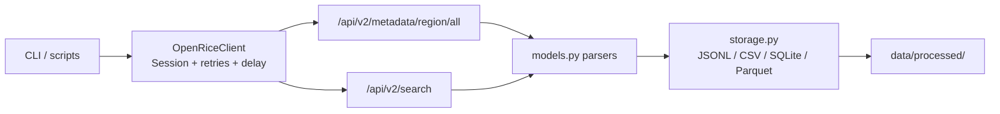

# OpenRice Web Scraping & Data Analysis

Portfolio project that collects Hong Kong restaurant listings from **OpenRice public JSON APIs**, stores them as portable files (JSONL / CSV / SQLite / Parquet), and keeps a small analysis starter. No MySQL passwords, no brittle HTML CSS selectors.

> Educational / portfolio use only. Be polite to the site: rate-limit requests, keep demos small, and do not redistribute scraped data commercially.

## Why JSON APIs instead of HTML scraping?

The original notebooks fetched restaurant **HTML pages**, parsed them with BeautifulSoup selectors, and parallelized with threads. That approach:

| HTML scrape (legacy) | JSON API (this rewrite) |
| --- | --- |
| Breaks when CSS / DOM changes | Stable field names (`poiId`, `name`, …) |
| Heavy pages + fragile parsers | Compact JSON payloads |
| Easy to overload the site with threads | Single session + configurable delay + retries |
| Often paired with hardcoded DB credentials | Default to local JSONL/CSV; optional SQLite |

OpenRice already exposes the same listing data the website uses:

1. **Metadata** — districts / regions  
   `GET https://www.openrice.com/api/v2/metadata/region/all?uiLang=zh&uiCity=hongkong`
2. **Search** — paginated POIs for a district  
   `GET https://www.openrice.com/api/v2/search?uiLang=zh&uiCity=hongkong&startAt=0&rows=N&districtId=XXXX`  
   Results live under `paginationResult.results[]`.

## Architecture



ASCII view:

```
cli.py ──► client.py ──► OpenRice JSON APIs
              │
              ▼
         models.py (Restaurant, DistrictMeta)
              │
              ▼
         storage.py ──► data/processed/*.{jsonl,csv,sqlite,parquet}
```

## Project layout

```
src/openrice_scraper/     # installable package
  client.py               # requests.Session, retries, delay
  metadata.py             # region/district fetch
  search.py               # startAt pagination + poiId dedupe
  models.py               # dataclasses + parsers
  storage.py              # JSONL / CSV / SQLite / Parquet writers
  cli.py                  # console entrypoint
scripts/scrape_sample.py  # one-liner demo scrape
analysis/                 # lightweight summaries (notebook ideas, simplified)
tests/                    # fixture-based unit tests (no network)
fixtures/                 # sample search JSON for tests
data/samples/             # legacy CSV/Parquet artifacts retained as samples
archive/legacy/           # old notebooks / SQL / XGB (superseded)
```

## Setup

```bash
python -m venv .venv
# Windows: .venv\Scripts\activate
# macOS/Linux: source .venv/bin/activate

pip install -U pip
pip install -e ".[dev,analysis]"
# or: pip install -r requirements.txt && pip install -e .
```

Requires Python 3.10+.

## Usage

### District metadata

```bash
python -m openrice_scraper.cli metadata
# or after install:
openrice-scraper metadata --out data/processed/districts.jsonl
```

### Scrape one district (demo-sized)

```bash
python -m openrice_scraper.cli scrape \
  --district-id 1001 \
  --rows 20 \
  --max-pages 1 \
  --out data/processed/sample.jsonl
```

Useful flags:

- `--delay 1.0` — seconds between HTTP calls (default `1.0`)
- `--max-pages 0` — no page cap (still be polite; prefer small demos)
- `--out path.csv` / `.sqlite` / `.parquet` — choose storage format
- `-v` — debug logging

Shortcut demo script:

```bash
python scripts/scrape_sample.py
python analysis/summarize_sample.py data/processed/sample.jsonl
```

### Tests (offline)

```bash
pytest -q
```

## Sample output fields

| Field | Source API key | Notes |
| --- | --- | --- |
| `poi_id` | `poiId` | Deduplication key |
| `name` / `name_other_lang` | `name` / `nameOtherLang` | ZH / EN-ish labels |
| `address` / `address_other_lang` | `address` / `addressOtherLang` | |
| `map_latitude` / `map_longitude` | `mapLatitude` / `mapLongitude` | |
| `score_overall` | `scoreOverall` | Overall score |
| `bookmarked_user_count` | `bookmarkedUserCount` | Popularity proxy |
| `photo_count` / `review_count` | `photoCount` / `reviewCount` | |
| `score_smile` / `score_cry` | `scoreSmile` / `scoreCry` | Sentiment tallies |
| `price_range_id` | `priceRangeId` | Price bucket id |
| `district_id` / `district_name` | `district.*` | |
| `categories` / `category_ids` | `categories[]` | Cuisine / dish labels |
| `shorten_url` | `shortenUrl` | Relative listing URL |

Example JSONL line (truncated):

```json
{"poi_id": 123456, "name": "…", "district_id": 1001, "bookmarked_user_count": 1200, "categories": ["日本菜", "壽司/刺身"]}
```

## Ethics & Terms of Use

- This project is for **learning and portfolio demonstration**, not commercial data resale.
- Respect OpenRice terms of service and robots / rate expectations: use a clear User-Agent, keep `--delay` ≥ 1s for demos, and cap `--rows` / `--max-pages`.
- Do **not** hardcode or commit database passwords. This rewrite defaults to local files; SQLite is optional and credential-free.
- Scraped content remains subject to OpenRice rights — do not republish bulk dumps.

## Legacy materials

Older notebooks (HTML + threads + MySQL), SQL ETL, Excel reports, and an XGBoost model JSON are under [`archive/legacy/`](archive/legacy/). Sample historical extracts live in [`data/samples/`](data/samples/). See [`archive/legacy/README.md`](archive/legacy/README.md).

## License

MIT — see [LICENSE](LICENSE).
